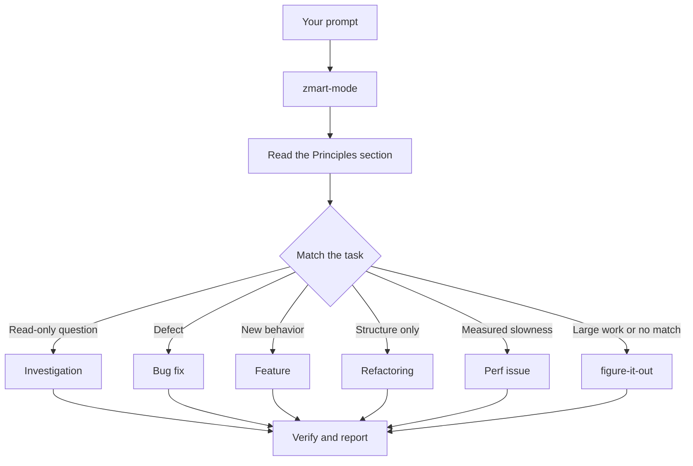

# Route work through `$zmart-mode`

`$zmart-mode` is the front door. You give it a goal, it matches one of twenty-two playbooks, tracks that playbook in the available plan tool or concise progress updates, and calls the other skills as the steps need them. In this page you learn what a good prompt looks like, and how little of one you actually need.

## What happens to your prompt



The diagram shows the common routes. There are also playbooks for hillclimbing a metric, diagnosing runtime symptoms and captured traces, prototypes, visual parity, authoring and evaluating skills, autonomous runs, opening a PR, babysitting a PR or stack to merge-ready, shipping a verified stack, running a PR queue or a stack on autopilot, session pickup, pausing safely, multi-phase plans, and worktree cleanup. The [playbook directory](../../skills/zmart-mode/playbooks/) has the full set.

## Say the goal, not the ceremony

You don't write a spec. You say what's wrong or what you want, plus anything you already know that saves the agent time:

```text
$zmart-mode users get two notifications after a retry. repro first, then fix and verify.
```

That's a Bug fix prompt. "repro first" is a real constraint, not politeness, and the playbook honors it. The plan follows the Bug fix steps.

## What goes in a prompt

A useful prompt carries up to five things, and each one fits in a sentence:

- **The goal.** Say what's wrong, or what you want.
- **The done check.** It must be able to pass or fail. "Make it better" and "work on it for an hour" aren't checks.
- **The proof you want to see.** Ask for the real command output, a video of the flow, the stored value, or a before-and-after number.
- **What you already know.** A symptom, a repro step, a log line, or a link saves the agent a search.
- **The real constraints.** "repro first", "don't change any code yet", "zero behavior change", and "let me review before proceeding" each change what the agent does.

Here's one prompt with all five:

```text
$zmart-mode the csv export drops its last row since yesterday's deploy. failing job id is 4812. repro first, then fix. done means the 60k-row fixture exports every row. show me the row counts before and after.
```

Two things are worth leaving out:

- **The how.** Say what to achieve, and leave the agent room to find a better path than the one you'd pick. The same goes for a list of skills, covered in the pitfall below.
- **Your theory of the cause, at first.** A stated guess narrows the search to wherever you pointed. Let the agent restate the problem before you share your hunch.

For a noisy report, such as a long thread or a vague bug, make the restatement the first step:

```text
$zmart-mode read this thread. restate the underlying issue in your own words, in plain english. don't change any code yet.
```

A misreading shows up in the restatement, before any code exists. Correct it there, and it costs you one message instead of one wrong fix. For the restatement alone, with no playbook, run [`$in-your-own-words`](../../skills/in-your-own-words/SKILL.md). It restates what the agent thinks your goals are and what problem you're trying to solve.

When you're unsure whether a prompt is aimed right, run [`$sharpen`](../../skills/sharpen/SKILL.md) on it before you send it:

```text
$sharpen write a migration guide for the v2 config format.
```

The agent says what a top professional would do that you didn't ask for, the rawest material they would start from, the methods and tools they would use, and what other than you or the agent would show the result is right. Then it rewrites your prompt to ask for exactly that, deeper but not bigger. The rewrite asks the agent to prototype any choice an experiment can settle and to recommend an option from what it observed, and it leaves product and preference choices to you. It doesn't do the task. Read the rewrite, then send it, for example with `$zmart-mode`.

When you can't name what you're after, run [`$reframe`](../../skills/reframe/SKILL.md) on your own description and files first:

```text
$reframe the settings page saves some fields right away and others only on submit, and people lose edits.
```

The agent gives 8 to 12 expert terms, ranked by how much each would change what you build. Each comes with the part of your description it names, a real project that uses it, with the link checked, and what it lets you ask an agent for. It also borrows terms from 2 or 3 neighboring fields that solved the same problem under other names, and says where each analogy breaks. Then it rewrites your description with the new words. Send the rewrite, or run `$sharpen` on it.

## Follow up short

When the conversation already carries the context, the prompt shrinks to almost nothing. All of these are enough:

```text
$zmart-mode do it
```

```text
continue
```

```text
keep going until done
```

Short follow-ups work while the task and playbook remain in context. Ask Codex to use `$zmart-mode` for the task and its follow-ups; invoke it again when starting a different task. Durable repository guidance belongs in `AGENTS.md`.

## Switch tasks with "new task"

A long chat accumulates context from the last task. When you change subjects, say so:

```text
$zmart-mode new task. figure out why the cache entry survives logout. don't change any code yet.
```

"new task" tells `$zmart-mode` to re-match rather than continue the prior playbook. "don't change any code yet" pins this one to Investigation. Without those two phrases, a mode mid-Feature tends to treat your question as the next feature step.

## Isolate parallel writers

Codex subagents may share the working directory. Assign disjoint file ownership when work is independent. Competing implementations or tasks that run conflicting builds need separate worktrees and distinct ports or output paths.

```text
$zmart-mode new task. use a fresh worktree off <base>, then port the parser change there.
```

The coordinator creates and names the worktree before delegating, and includes its absolute path in the worker brief. A `spawn_agent` call does not create a VM or worktree. Remote execution is used only when the session actually offers it.

Worktrees accumulate. When disk gets tight, ask:

```text
$zmart-mode what's eating my disk? prune the worktrees that are safe to prune.
```

The [Worktree cleanup playbook](../../skills/zmart-mode/playbooks/worktree-cleanup.md) classifies every worktree by merge state, uncommitted work, and which chats still touch it. It deletes only what that evidence clears and pauses for your call on anything holding uncommitted work.

## Leave it running

When you step away, say what done means and go:

```text
$zmart-mode im stepping away. keep going until the migration check reports zero old callers. log your decisions.
```

Work you'll review later routes through [`$figure-it-out`](../../skills/figure-it-out/SKILL.md), which designs the run's phases and keeps a [`$show-me-your-work`](../../skills/show-me-your-work/SKILL.md) decision log. [Run work while you sleep](./07-overnight.md) covers the full overnight contract.

**Pitfall:** don't enumerate skills in your prompt ("use $architect, then $arena, then $interrogate..."). The playbook already sequences them, and a hand-written sequence usually reorders or drops steps the playbook would have kept. Name a skill only when you want to override a specific choice.

Read [`zmart-mode`](../../skills/zmart-mode/SKILL.md) itself for the full routing rules.

Next: [Understand the code](./03-understand.md).
