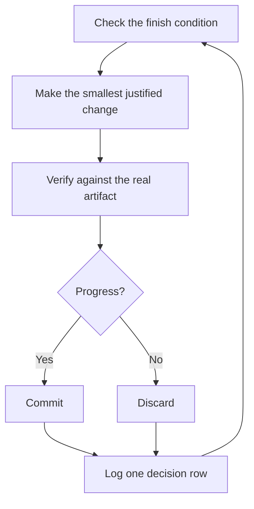

# Run work while you sleep

This is the payoff for everything before it. An agent you can trust to verify its own work is an agent you can leave alone with a hard task. What makes that safe isn't hope. It's a checkable finish condition, an isolated worktree, and a decision log you audit in the morning.

## Earn the trust before the loop

A loop you don't trust just produces unchecked work faster, and the mess compounds with every iteration. Before you leave one running, check that it has earned it:

- You've done the task once by hand, or watched an agent do it, so you know what good looks like.
- The agent has the tools and signals you'd use yourself: the verification skill, the profiler, the logs.
- Every stage proves its work and can stop the line when the work misses the bar.
- You've read a few transcripts and turned the repeated failures into tools, skills, or checks.

Make the loop autonomous only after all four hold. Until then, run it while you watch.

## The overnight contract

A good handoff has the goal, the finish condition, permissions, and an escape hatch. It doesn't need to be long:

```text
$zmode im going to bed. migrate every caller to the new parser in a fresh worktree off <base>.
done means zero old callers, all parser fixtures pass, old api deleted.
keep a decision log. don't ask me before committing.
continue until done. if you hit a blocker you cannot resolve, report the evidence and resume point.
```

Walk through what each line buys you:

- “im going to bed” asks for autonomous progress within the stated scope and the session’s permissions.
- "done means..." turns the goal into checks every iteration can run.
- "fresh worktree off `<base>`" keeps the run from colliding with anything else you have open.
- "don't ask me before committing" pre-answers the permission the agent would otherwise block on.
- The [Autonomous run playbook](../../skills/zmode/playbooks/autonomous-run.md) keeps checking the finish condition in the active chat. If you explicitly request a Codex goal and goal tools are available, it uses them; otherwise it continues the task directly. A prompt cannot guarantee execution after the app or execution host stops.
- The escape hatch lets it stop at a genuine dead end and write up why, which beats eight hours of creative goal reinterpretation.

Because you'll review this work after stepping away, `$zmode` routes it through [`$figure-it-out`](../../skills/figure-it-out/SKILL.md), which designs the run's phases before any code and wires in the decision log.

To stop a run on purpose, tell the agent to pause, or that you're about to go offline or restart Codex. The [Pause safely playbook](../../skills/zmode/playbooks/pause-safely.md) finishes or backs out of the current step, commits a work-in-progress checkpoint, and writes a resume note. A fresh chat picks the work up from that note through the Session pickup playbook. Saying "keep going" never triggers a pause.

## What the loop does all night



One change, one check, one log row, every iteration. Changes that didn't help get discarded, not left to ride. A plateau means pivot, not stop, and the finish condition never quietly relaxes to declare victory.

## The morning audit

[`$show-me-your-work`](../../skills/show-me-your-work/SKILL.md) is what makes the run reviewable. Each row records the time, phase, decision, reason, an evidence pointer, and the result, in a TSV at `decisions.tsv` (or `.audit/<task-slug>.tsv` when several runs share a directory). It stays local by default. Commit it when the work is ambitious enough that a reviewer needs the trail to trust the result.

When you're back, ask for the run in review form:

```text
$show-me-your-work catch me up on what you did last night
```

Before the skill hands back its summary, it spawns an independent reviewer to read the trail and the transcript, and the reply ends with an Attention section listing what deserves your scrutiny. Read that section first, then the log rows it points at. You're auditing decisions, not re-reading the whole night.

For a quick status instead of an audit, run [`$ketchup`](../../skills/ketchup/SKILL.md) in the chat that ran the work. It reads only, and tells you in plain words what changed since your last message, with the screenshots and small diagrams the work produced. Then it lists each call waiting on you, such as a merge, an approval, or a choice between options, with its pick, the evidence, and the risk, so you can decide from the reply alone.

## When the night holds a queue, not a task

The contract above drives one task to one finish condition. Some nights hold more, a queue of independent changes or a whole program. Two playbooks and one skill scale the same trust up.

[Autopilot-full](../../skills/zmode/playbooks/autopilot-full.md) runs a queue of independent PRs to merged. Each PR gets one owner agent that carries it from build through merge, and no owner merges on its own verdict. A swarm of fresh verifiers checks the owner's code-ready head. A later rebase or minor fix gets one fresh verifier, and only new behavior or a large new diff calls the full swarm again. Only a clean verdict on the patch that merges authorizes the merge:

```text
$zmode full autopilot on this queue. each item is independent. i want them merged by morning.
```

[Autopilot-stack](../../skills/zmode/playbooks/autopilot-stack.md) is Autopilot-full without the merge. You wake up to verified PRs, each with its verdict, and you review and land them yourself. A PR stacks only on a PR it builds on. Pick it over Autopilot-full when you want your own eyes on the work before anything merges:

```text
$zmode autopilot these five changes, but don't merge. i'll land them in the morning.
```

A whole program, such as a migration across many packages, has no playbook of its own. `$zmode` routes large or cross-cutting work to [`$figure-it-out`](../../skills/figure-it-out/SKILL.md), which designs one rigorous run for it:

```text
$zmode migrate every package to the new store. own it until each one is converted and merged. i'll check in twice a day.
```

## Run many projects in parallel

Use a separate Codex project or chat for each substantial body of work. The coordinator can delegate subtasks through the tools available in that session. Give workers the [worker brief](../../skills/zmode/worker.md), a concrete completion check, and an isolated worktree or disjoint ownership.

Related chats are useful context only when a thread tool can retrieve them or you provide their contents. Do not assume that grouping chats exposes all their history to workers. Local subagents do not imply cloud execution or continued work while the host sleeps.

For a queue of independent PRs, use Autopilot-stack for verified drafts or Autopilot-full when merging is explicitly authorized. Each PR still needs a fresh verifier for the revision being merged.

```text
$zmode refactor this repo so its architecture is easier for agents to use. use $correct and $architect to find recurring mistakes. use accessible history as evidence and prototypes to answer technical questions. come back with a plan backed by data. wait for me to approve implementation.
```

## Let loops start themselves

Every loop above still waits for you to start it. A scheduled automation can start recurring work when the Codex session offers automation tools. Event triggers require a separately supported integration; do not assume Slack events can wake a Codex automation. Software maintenance splits into stages that suit this well: triage a report, reproduce it, fix it, verify the fix. Two rules keep such a line trustworthy:

- Every stage can stop the line. Triage can decide the report is expected behavior, repro can fail to reproduce it, and the fixer can judge the change too risky. Each of those outcomes is useful, because it keeps bad work from reaching the next stage, where it costs more to undo.
- Every stage hands over evidence. Repro attaches screenshots and video of the broken state, and the fix attaches before-and-after proof. A human can then check that the agent fixed the right thing before reading a line of code.

zstack ships this as a dormant [automation pack](../../automations/ztriage/README.md) for Slack issue reports. One automation triages each report. The other reproduces confirmed bugs and may prepare a small draft fix. Point an agent at its [`FOR_AGENTS.md`](../../automations/ztriage/FOR_AGENTS.md) and name the target repository to set it up.

**Pitfall:** a duration is not a finish condition. "work on this for 4 hours" gives the agent nothing to check, and you'll wake up to four hours of motion instead of a result. Give the run a predicate that can pass or fail.

Next: [Steer with principle names](./08-principles.md).
